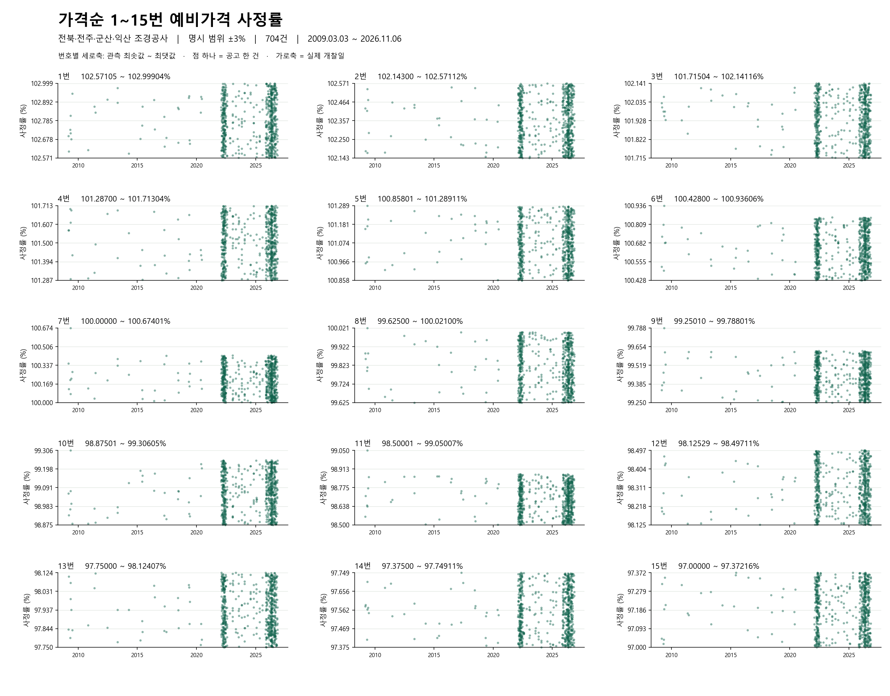

# 가격순 1~15번의 예비가격 사정률

공고별로 복수예비가격을 높은 순서대로 정렬했습니다. 1번은 가장 높은 가격입니다. 각 그래프의 세로축 하단은 **해당 번호의 관측 최솟값**, 상단은 **최댓값**입니다. 패널 제목에 두 값을 표시했습니다. 가로축은 모두 동일한 개찰일 범위입니다. 점은 실제 관측값입니다.

- 분석 기간 2009.03.03 ~ 2026.11.06, 고유 공고·차수·분류·재입찰 조합 **704건**, 가격 관측 **10,560개**.
- 공식 예가 범위가 **−3%~+3%**로 명시된 자료에서 기초금액, 원본번호 1~15, 선정 4개 및 선정 평균과 예정가격을 대조했습니다. 중복 건은 한 번만 집계했습니다. 사정률은 예비가격 / 기초금액 × 100입니다.
- 전북 광역 및 전주·군산·익산 단독 지역 제한 조경식재·조경시설물 공사가 대상입니다. 2025년 11월 이후 기존 수집 자료에, 전북 조경공사 검색을 반기별로 나눠 목록의 모든 페이지를 확인했습니다. 공고명 ‘조경’ 검색은 2002년부터, 업종코드 4993 검색은 2022년부터 2026년 11월 7일까지입니다. 두 검색의 중복 공고는 한 번만 포함합니다. [기간별 조회 현황](search-coverage.csv)의 pending은 상세 확인 대기 건수입니다. [상세 조회 오류](detail-errors.csv)도 별도로 기록합니다. 범위를 확인하지 못한 과거 가격은 제외했습니다.
- 연도별 포함 건수: 2009년 7건, 2010년 1건, 2011년 2건, 2012년 1건, 2013년 2건, 2014년 1건, 2015년 3건, 2016년 2건, 2017년 3건, 2018년 3건, 2019년 4건, 2020년 3건, 2022년 211건, 2023년 29건, 2024년 21건, 2025년 57건, 2026년 354건.
- 가격순 1번 중앙값 **102.77904%**, 관측값의 10~90백분위 **102.61500~102.94874%**.

[공고별 15행 CSV](notice-rates.csv) · [고해상도 PDF](rank-history.pdf) · [전체 관측 CSV](observations.csv) · [번호별 통계 CSV](summary.csv) · [나라장터 원문 검색](https://www.g2b.go.kr/) · [그래프 재생성 코드](plot.py)

## 번호별 관측 범위 (%)

| 가격순 번호 | 최솟값 | 10백분위 | 중앙값 | 90백분위 | 최댓값 |
|---:|---:|---:|---:|---:|---:|
| 1 | 102.57105 | 102.61500 | 102.77904 | 102.94874 | 102.99904 |
| 2 | 102.14300 | 102.17738 | 102.34510 | 102.52574 | 102.57112 |
| 3 | 101.71504 | 101.75349 | 101.93500 | 102.10108 | 102.14116 |
| 4 | 101.28700 | 101.33107 | 101.50311 | 101.67174 | 101.71304 |
| 5 | 100.85801 | 100.89838 | 101.07164 | 101.24079 | 101.28911 |
| 6 | 100.42800 | 100.47106 | 100.64401 | 100.81506 | 100.93606 |
| 7 | 100.00000 | 100.04435 | 100.20812 | 100.37551 | 100.67401 |
| 8 | 99.62500 | 99.66203 | 99.81201 | 99.96502 | 100.02100 |
| 9 | 99.25010 | 99.29440 | 99.43802 | 99.58900 | 99.78801 |
| 10 | 98.87501 | 98.90709 | 99.06601 | 99.21015 | 99.30605 |
| 11 | 98.50001 | 98.53703 | 98.69005 | 98.82945 | 99.05007 |
| 12 | 98.12529 | 98.15938 | 98.30353 | 98.45882 | 98.49711 |
| 13 | 97.75000 | 97.79134 | 97.93021 | 98.09073 | 98.12407 |
| 14 | 97.37500 | 97.40915 | 97.54703 | 97.71175 | 97.74911 |
| 15 | 97.00000 | 97.03335 | 97.19200 | 97.33712 | 97.37216 |

최솟값과 최댓값은 이 표본에서 실제 관측된 값입니다. 다음 공고의 보장 범위로 해석할 수 없습니다.

## 공고별 15행 CSV

[CSV 다운로드](notice-rates.csv). 공고번호 필드는 공고번호:차수:분류:재입찰차수로 구성됩니다. 각 공고에서 높은 예비가격부터 번호를 매깁니다. 편차(%p) = 직전 번호 사정률 − 현재 번호 사정률이며, 1번은 빈칸입니다. 원단위 가격으로 계산한 뒤 소수점 다섯째 자리까지 반올림합니다.

## 실제 개찰연도별 확보 건수

조경식재와 조경시설물을 합산했습니다. [연도별 건수 CSV](yearly-counts.csv)의 추가 확보는 처음 공개한 552건(커밋 999fbd8) 이후 검산을 통과한 고유 공고 수입니다.

|개찰연도|기존|추가|합계|
|---|---:|---:|---:|
|2002|0|0|0|
|2003|0|0|0|
|2004|0|0|0|
|2005|0|0|0|
|2006|0|0|0|
|2007|0|0|0|
|2008|0|0|0|
|2009|3|4|7|
|2010|1|0|1|
|2011|2|0|2|
|2012|1|0|1|
|2013|2|0|2|
|2014|1|0|1|
|2015|3|0|3|
|2016|2|0|2|
|2017|3|0|3|
|2018|3|0|3|
|2019|4|0|4|
|2020|3|0|3|
|2021|0|0|0|
|2022|63|148|211|
|2023|29|0|29|
|2024|21|0|21|
|2025|57|0|57|
|2026|354|0|354|
|**합계**|552|152|704|
